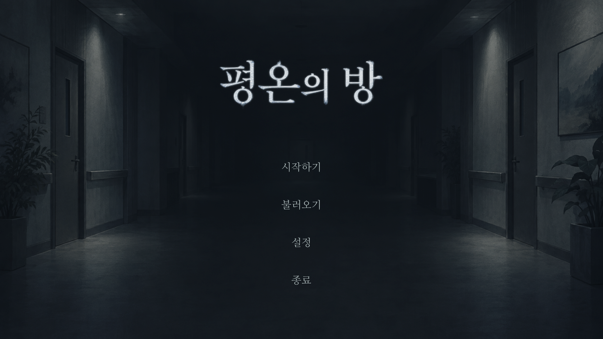
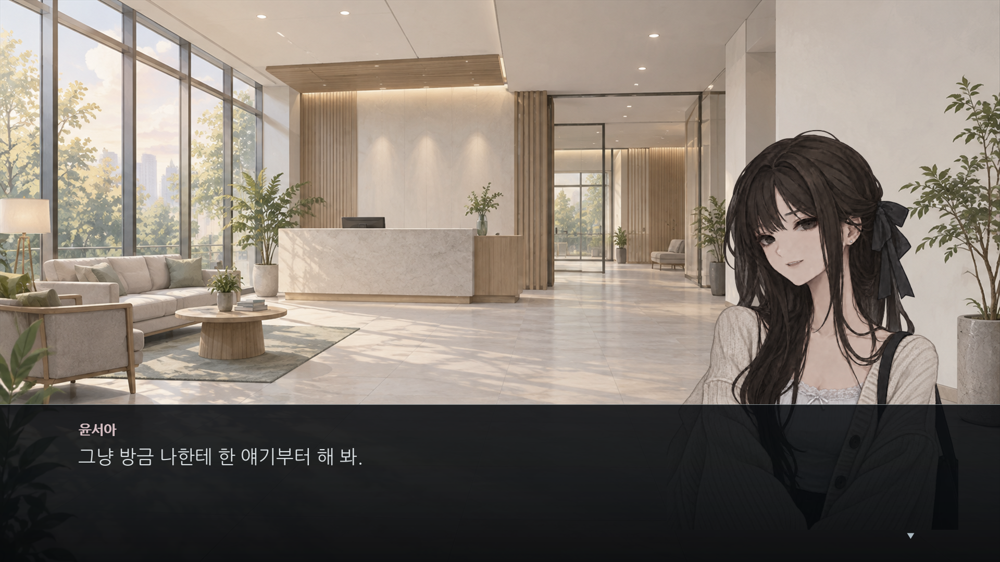
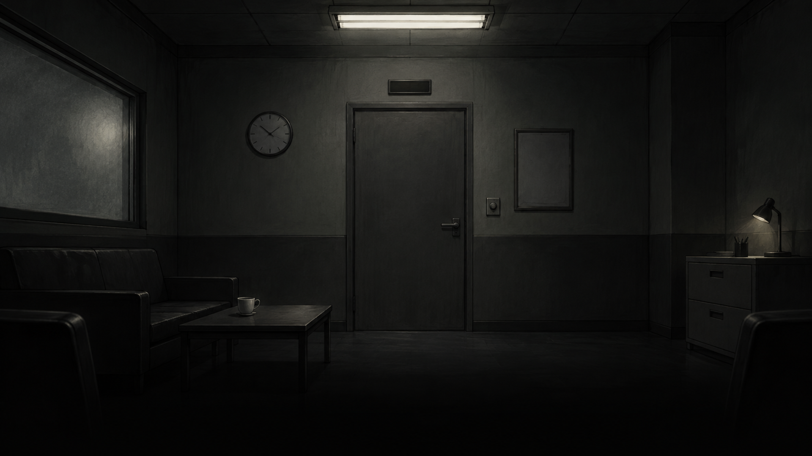
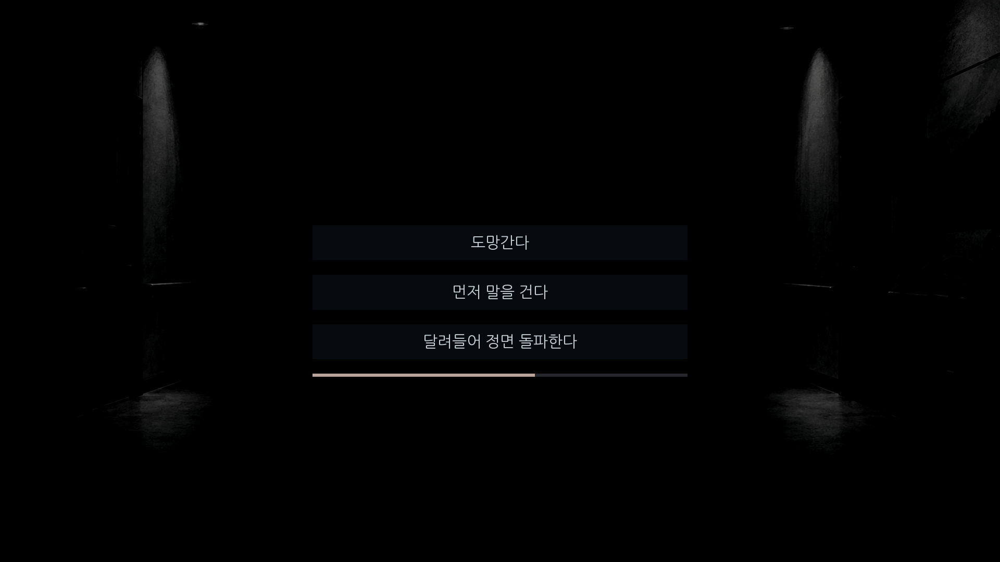

# 평온의 방

**정적과 발소리, 그리고 선택으로 긴장감을 만드는 1인칭 심리 공포·탈출 게임.**

회복 프로그램에 참가한 김수혁은 낯선 방에서 눈을 뜹니다. 휴대폰은 사라졌고, 문은 열리지 않습니다. 겨우 방을 나선 뒤에는 어둠 속에서 다른 발소리를 듣습니다. 내가 멈추자, 그 발소리도 멈춥니다.

눈앞에 위협을 직접 보여 주기보다, 보이지 않는 공간과 소리의 간격을 통해 플레이어가 상황을 상상하도록 만들었습니다.

| 항목 | 내용 |
| --- | --- |
| 장르 | 스토리 중심 심리 공포 · 포인트 앤 클릭 탈출 |
| 플랫폼 | Windows 64비트 |
| 엔진 | Ren'Py 8.5.3 / Python |
| 언어 · 화면 | 한국어 / 1920 × 1080 기준 |
| 현재 범위 | 로비 도입 → 방 탐색 → 복도에서의 만남과 선택까지의 데모 |
| 제작 방식 | 개인 기획 · 생성형 AI를 활용한 개발 및 에셋 제작 |

## 플레이 화면

아래 이미지는 실제 플레이 화면입니다. 주요 결말은 포함하지 않았습니다.

### 익숙한 사람과 낯선 장소

평온한 로비에서 시작하는 대화. 인물의 표정과 수혁의 기억을 통해 관계를 소개하고, 이후의 어두운 공간과 대비시킵니다.

### 직접 살펴보는 방

사물을 직접 클릭해 조사하고 나갈 방법을 찾습니다. 배포판에서는 조사 위치를 알려 주는 문구와 버튼 표시를 숨겨, 공간을 살펴보는 행동에 집중하도록 했습니다.

### 멈출 수 없는 선택

상대의 모습이 보이지 않는 복도에서 행동을 결정합니다. 긴박한 선택에는 줄어드는 시간 바와 빠른 틱톡 소리가 함께 나오며, 선택에 따라 대화 또는 배드엔딩으로 이어집니다.

## 주요 구현

- **탐색과 진행 상태**: 방 안의 8개 사물 조사 여부를 관리하고, 필요한 조사를 마치면 다음 연출로 연결합니다.
- **선택의 긴박감 구분**: 문 앞 선택에는 제한 시간이 없습니다. 복도 선택은 7초 동안 바가 줄어들고, 0.5초의 추가 입력 시간을 둡니다. 시간 초과도 별도 실패 분기로 처리합니다.
- **소리와 정적의 연출**: 플레이어와 상대의 발소리를 구분하고, 걸음을 멈춘 뒤 정적을 배치합니다. 긴박한 선택이 끝나면 틱톡 소리도 멈춥니다.
- **읽기와 조작**: 글자 출력 속도 조절, 클릭·Enter·Space로 즉시 출력, 출력 완료 표시를 제공합니다.
- **메뉴와 기록**: ESC 메뉴에서 조사 기록, 지난 대사, 인물, 저장·불러오기, 설정을 확인할 수 있습니다.
- **재도전**: 배드엔딩 이후 선택 직전으로 돌아갈 수 있습니다.
- **개발·배포 표시 분리**: 개발 환경에서는 조사 위치를 표시할 수 있고, 배포판에서는 표시와 관련 설정을 숨깁니다.

## 실행 방법

### 제출된 데모 플레이

1. 포트폴리오에 첨부된 Windows 데모 ZIP을 폴더 전체로 압축 해제합니다.
2. 폴더 안의 게임 실행 파일(`.exe`)을 실행합니다. 실행 파일만 다른 곳으로 옮기지 마세요.
3. Ren'Py나 Python은 별도로 설치하지 않아도 됩니다.

이 저장소의 `Code → Download ZIP`은 소스 코드입니다. 실행용 데모 ZIP과는 별개입니다. 상세 안내는 [데모 실행 안내](DEMO-README.md)를 참고하세요.

| 입력 | 동작 |
| --- | --- |
| 클릭 / Enter / Space | 글자 즉시 출력 · 다음 대사 |
| 사물 클릭 | 방 조사 |
| ESC | 메뉴 열기 |
| N | 조사 중 기록 열기 |

발소리와 정적이 중요한 게임입니다. 소리를 들을 수 있는 환경에서 적당한 음량으로 플레이해 주세요.

### 소스에서 실행

1. Ren'Py SDK 8.5.3과 Git LFS를 준비합니다.
2. 저장소를 클론하고 저장소 폴더에서 `git lfs pull`로 게임 에셋을 받습니다.
3. Ren'Py 런처에서 프로젝트를 인식시킨 뒤 실행합니다.

## 제작 역할과 AI 활용

제작자가 이야기의 방향, 인물 관계, 데모 범위와 연출 의도를 정하고, 직접 플레이하며 문장·음향·UI의 수정 사항을 판단했습니다.

ChatGPT·Codex를 활용해 시나리오 초안을 다듬고 Ren'Py 코드와 보조 스크립트를 작성·수정했습니다. 인물·배경·로고 제작에도 생성형 AI를 활용했으며, 결과물을 선택하고 게임 화면에 맞게 조정했습니다. 효과음과 안내 음악은 Python으로 합성했습니다. 인물 음성은 사용하지 않습니다.

에셋 출처와 글꼴 라이선스는 [제작 자료](CREDITS.md)에 정리했습니다.

## 개발 과정

기억을 지우고 같은 장면으로 돌아오는 초기 구조에서 출발해, 고립된 공간을 탐색하고 낯선 사람을 경계하는 탈출 이야기로 방향을 바꿨습니다. 이후 실제 플레이를 바탕으로 대사의 길이, 대화창의 가독성, 조사 UI와 선택지 음향을 반복해서 다듬었습니다.

**[개발 과정과 주요 수정 이유 읽기](docs/개발-과정.md)**

## 코드와 문서

| 경로 | 역할 |
| --- | --- |
| [game/script.rpy](game/script.rpy) | 로비 대화, 방 탐색, 문 앞 선택 |
| [game/corridor_demo.rpy](game/corridor_demo.rpy) | 복도 연출, 시간제한 선택, 데모 종료와 실패 분기 |
| [game/state.rpy](game/state.rpy) | 조사 대상, 기록, 진행 상태 |
| [game/screens.rpy](game/screens.rpy) | 대화창, 탐색 화면, 메뉴와 설정 |
| [game/tests.rpy](game/tests.rpy) | 진행·분기·시간 초과·재도전 테스트 시나리오 |
| [tools/make_audio.py](tools/make_audio.py) | 효과음과 안내 음악 합성 |
| [구현 핵심 원칙](docs/구현-핵심-원칙.md) | 시점, 문장, 시각·음향 연출 기준 |

후속 이야기와 인물 관계는 설계 중입니다. [줄거리·세계관 기준](docs/줄거리-세계관-기준.md)에는 **데모 이후의 스포일러**가 포함되어 있습니다. [구 장면 1 명세](docs/장면1-구현명세.md)는 초기 설계 이력으로 보존하며 현재 요구사항과는 구분합니다.
